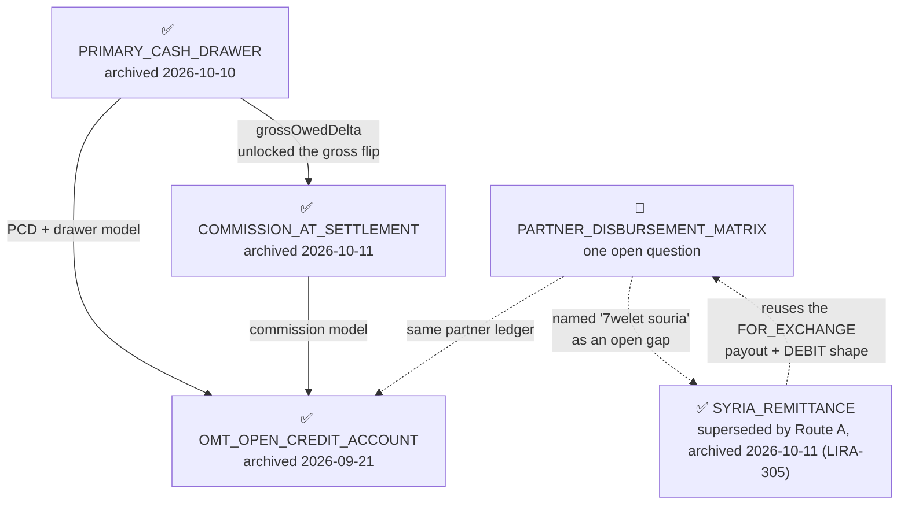
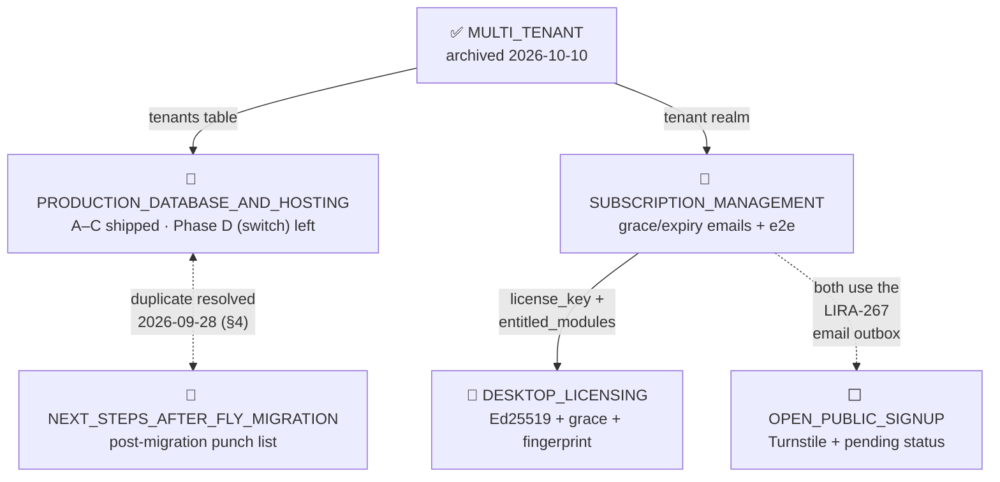
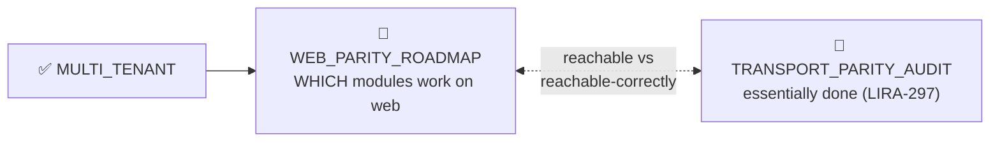
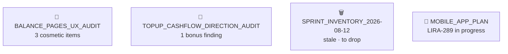

# Plan Overview — the live board, verified against source

> **This is a LIVING DOCUMENT. Never archive it.** Like `WEB_PARITY_ROADMAP.md`, it has no
> completion state — it is the map, not a plan.
>
> **Scope: only work that is still open.** Finished plans are not listed here; they live in
> `done_plans/` as the design record. This page is what is left, and nothing else.
>
> **Built 2026-09-16** by reading every plan in `todo_plans/` + `ongoing_plans/` and checking
> **each** claimed artifact against source — the migration, the table/column, the constant, the
> repository method, the REST route, the component, the spec file. **No status line was taken at
> face value.** Where a plan's header disagreed with the code, the code won.
>
> **Last updated 2026-10-11** — `SYRIA_REMITTANCE_PLAN.md` archived as superseded (not built: the owner's Route A —
> Custom Services → Via Partner + Pay out, v185 — is the corridor; LIRA-305 added the partner-netting profit rule and the
> end-to-end proof; decisions Y1–Y14 in `OVERNIGHT_DECISIONS_2026-10-11.md` §3). Earlier the same day:
> `COMMISSION_AT_SETTLEMENT_PLAN.md` closed and archived (its
> LIRA-108 residual and Phase 4 finished overnight; decisions C1-C6 in
> `OVERNIGHT_DECISIONS_2026-10-11.md`). Previous update 2026-10-10 — audit refresh: `OWNER_NOTES_2026-09-21` references cleared (closed
> 2026-10-02), six finished plans archived, §2d rebuilt from the real open owner questions, and the
> web-parity / transport-parity rows brought up to LIRA-297.

---

## 0. How to read this, and how it got clean

The 2026-09-16 sweep checked 26 plans and found **11 of them finished and filed as unfinished** —
42% of the board. Those 11 have been archived, and 7 more that had genuinely started were moved
out of `todo_plans` (which means "nothing built yet") into `ongoing_plans`.

**The sweep left a real board of 17 plans** — much smaller than the folders used to suggest.
**Now 14** — counted from the folders on 2026-10-11: **11 ongoing + 3 todo** (plus this file).
`OWNER_NOTES_2026-09-21.md`, `OWNER_NOTES_REMAINING_BUILD.md` and
`LIRA-219_CLOSING_PROFIT_PARITY.md` all shipped in `9ed8d90f` (2026-09-25) and were archived
2026-10-02 (`340a9446`) — all 29 owner notes done or owner-decided. **Archived 2026-10-10:**
`PRIMARY_CASH_DRAWER_PLAN.md` (cosmetic tail done in `34703ade`), `OWNER_NOTES_TASK_PLAN.md`
(LIRA-083/084/086/087 in `b802dae7`, LIRA-088 in `9ed8d90f`), `MULTI_TENANT_IMPLEMENTATION_PLAN.md`
(WP9 = `lira-web-038`, `640a7c76`, LIRA-099), `SELF_SERVE_SIGNUP_AND_GOOGLE_PLAN.md`
(LIRA-278–281), `profit-audit-2026-09/` (LIRA-185) and `POSTING_INTEGRITY_PLAN.md` (LIRA-258; only
the optional Phase 5 is left, noted below).
`OMT_OPEN_CREDIT_ACCOUNT_PLAN.md` was archived 2026-09-21 when its confirming web run came back
green — the last thing it was waiting on. `LIRA-194` was archived the same day: opened by the
owner 2026-09-20, shipped 2026-09-21 (`9c0194cd`) — one day on the board, moved with its code.
`SYRIA_REMITTANCE_PLAN.md` was added 2026-09-17; `LIRA-194` was opened by the owner on
2026-09-20; `LIRA-196` was split out of the `lira-web-027` investigation on 2026-09-21 so the
narrow fix could ship without waiting on an owner decision about tenant timezones.

**2026-09-23 — what the last batch shipped, and what it added.** Three of `OWNER_NOTES`' proposed
tickets were built and are now filed DONE in `current_sprint.md`: **LIRA-198** (the audit page is
visible to staff — migration **v178**, the `["admin","staff"]` widening on both transports, and the
per-tenant `TenantRepository.seedModules` fix), **LIRA-205** (a Ret. Credits column on the
transactions table, plus one identical cross-transport failure message for the admin-only row
actions) and **LIRA-208** (Adjust Stock reachable from the product edit form, plus a second silent
D13 no-op closed). Alongside them, `electron-app/create_db.sql`'s **rule-10 breach was repaired**
(8 missing `schema_migrations` seed rows, 6 drifted seed names) and the dormant
`scripts/check-schema-equivalence.mjs` was **extended and wired into CI** so that class of drift
fails loudly from now on. **Two owner decisions** were taken and are recorded in `OWNER_NOTES` §0.5:
audit scope is **BROAD** (staff keep both the Transactions and the Audit Log tabs), and the row
actions stay **visible** to staff rather than being hidden behind a role check. Nine follow-up
tickets — **LIRA-220 … LIRA-228** — were filed out of that work; **LIRA-229** and **LIRA-230** came out of the 2026-09-24 Profits audit, and **LIRA-231** (POS refunds via the payment form) out of the owner's 2026-09-26 test; **LIRA-232 … LIRA-235** (session item refund, #14 slice 3, two transport fixes, the web staff-login helper) were filed the same day; **LIRA-236** (refund form exchange rate) on 2026-09-27. **LIRA-237 … LIRA-239** (web timezone reports, old-data repairs, #28 verify) were filed on 2026-09-28. **LIRA-240 … LIRA-250** came out of the 2026-09-28 exploratory web test. **LIRA-251** (tenant-scoping linter gap) was filed on 2026-09-28. The next free ID is **LIRA-252**.

**2026-09-25 → 2026-10-02 — `OWNER_NOTES_2026-09-21.md` finished.** The batch (four money bugs,
the Profits-page audit, the Dashboard chart/tile, the widened LIRA-219 and the remaining notes)
shipped in `9ed8d90f` (2026-09-25); the follow-ups and the confirming e2e landed in `24651e83` and
`8cf9361d`; the plan was closed and archived on 2026-10-02 (`340a9446`) with all 29 notes done or
owner-decided. Nothing from it is open on this board.

Two plans were opened **and** closed on 2026-09-20 without ever outliving a day on this board:
`REMAINING_DESKTOP_E2E_FAILURES.md` (4 desktop specs) and `LIRA-195` (4 web specs). Both were
stale-spec fixes, both are archived in `done_plans/`, and both moved in the same change as
their code — which is the habit described below actually being followed rather than described.

**Why the rot happened, in one line:** a status line is written once, when the plan is written,
and whoever later ships the work updates the code and the sprint file but not the plan. Six of
the eleven archived plans were completed by a commit landing *days after* that plan's own internal
"validation pass" declared the item missing.

**Two habits that prevent a repeat:**

1. When you finish a plan's last item, **move the file in the same commit as the code.**
2. When a plan says a phase is missing, **`ls` or `grep` for the artifact before believing it.**
   That single check would have caught all eleven.

---

## 1. The live board

**Size** is the remaining work only, not the original plan. **Money** means the remaining work
writes transactions, payments, drawers, ledgers or profit.

### `ongoing_plans/` — started, unfinished (11)

| Plan | What's actually left | Size | Money |
| --- | --- | --- | --- |
| `TOPUP_CASHFLOW_DIRECTION_AUDIT.md` | 1 finding. Primary scope fixed (`7b076724`); the self-declared "bonus finding" is open — `EXCHANGE` is hardcoded `direction: "both"` (`transactionPresentation.ts:80`), ignoring the for-partner variant | Small | no (badges) |
| `BALANCE_PAGES_UX_AUDIT.md` | 3 of 7 convergence items, all cosmetic. Critical colour bugs fixed (`d40fd6e5`, shared `balanceColor.ts`). Open: unify money formatters, Partners reversal-row marker, "Refunded" vs "VOIDED" wording | Small | no |
| `PARTNER_DISBURSEMENT_MATRIX.md` | **No code — one unanswered question.** All 3 money-risk findings fixed (`2e9e822a`, `43c7450e`). The audit flagged an assumption that was never put to you: on a FOR-partner **RECEIVE**, does the shop hand the customer cash (drawer goes down) or does the partner pay? (§2d) | Question only | yes |
| `SUBSCRIPTION_MANAGEMENT_PLAN.md` | `tenants.email` + grace-period notices — needs a mail capability, now **provided by LIRA-267** (email outbox + SMTP, live in production 2026-10-07, plus `tenants.contact_email`); plus one e2e. Its §7 is stale: the "no owner UI" gap was closed by `PlanModal.tsx` (`e78da1b3`) | Medium | yes |
| `TRANSPORT_PARITY_AUDIT_PLAN.md` | **Essentially done by LIRA-297** (2026-10-10): `scripts/check-transport-parity.mjs` exists and runs in `ci.yml` (`yarn check:transport-parity`, allowlist for rule C1), and write-path adapter payloads are typed from core schemas — no `any` payload params left. Left: ~80 `Promise<any…>` return types in `packages/ui/src/api/types.ts` | Small | no |
| `DESKTOP_LICENSING_PLAN.md` | Phases 1-5: `last_check_in` + machine fingerprint, Ed25519-signed licence blob, key moved to `userData`/`safeStorage`, 30-day grace UI, clock-tamper freeze. Its own "🔴 URGENT" hazard was already fixed by `805fc45a` — *one minute before the doc was committed* | Large | yes |
| `PRODUCTION_DATABASE_AND_HOSTING_PLAN.md` | **Only Phase D left** (the switch to per-tenant files). Phases A–C shipped 2026-09-27/28 (`4dcd16c0`…`7c150b2f`, deployed, prod still `TENANT_DB_MODE=shared`); the split was dry-run on a production snapshot and passed. Runbook § 12.4; owner schedules the window | Small | yes |
| `NEXT_STEPS_AFTER_FLY_MIGRATION.md` | `DATABASE_KEY` log line still lies (no canary in `sqlcipher.ts:39`); signup URL-code prefill. Its per-tenant-split item now points at the hosting plan (resolved 2026-09-28, see §4) | Medium | yes |
| `LANDING_PAGE_PLAN.md` 🆕 | Landing page LIVE on `liratek.shop` since 2026-10-07 (Phases 1–2, verified). Video chosen (/brag, 3b) and shipped. Left: SPF/DMARC + Search Console (4) | Small | no |
| `MOBILE_APP_PLAN.md` 🆕 | **LIRA-289, first phone version built 2026-10-10 (39/62 tasks).** Expo SDK 55 app (`mobile/`), with sign-in by shop address, live balances, Whish/OMT App transfers on account or into a wallet, customer debts and wallet repayments, and the since-last-count view. Server: mobile login, Idempotency-Key (v208), since-last-count on both transports. Shared with web: the wallet-transfer builder, local-date reports and the count panel. Left: APK release to cornertech, phone UI tests, store readiness. Deferred: Google, Binance and vouchers | Medium | yes (posts through existing money routes, money-tested) |
| `WEB_PARITY_ROADMAP.md` 📖 | **Living tracker — never archive.** Phase 3 is essentially done: **117 of 118 desktop specs run in web mode** (LIRA-297, `37015d45` + follow-ups); only `lira-085` stays desktop-only (the setup wizard is Electron-only). Its own Phase 3 count ("7 of 87 specs") is stale, and two §9 items are already fixed but still listed | Small | yes |

### `todo_plans/` — genuinely not started (3)

| Plan | What's there | Size | Money |
| --- | --- | --- | --- |
| `OFFLINE_DESKTOP_FALLBACK_PLAN.md` | **Superseded 2026-10-11 by LIRA-306** (`specs/306-offline-desktop-fallback/`): redesigned live by the owner on an events model (web never locked, every cashier action offline, per-PC local copies). 148/152 tasks done, web side deployed (v85); left: desktop release, Windows test, two-PC drill, Phase D. Follow-ups in `current_sprint.md` › LIRA-306 | Large | yes |
| `OPEN_PUBLIC_SIGNUP_PLAN.md` | LIRA-267 covers Turnstile and the verified contact email (§3.1, §3.3). Turnstile is built (LIRA-267) but not configured in production (owner decision 2026-10-07); `SIGNUP_INVITE_CODE` is removed (sign-up is by emailed invite link only). Still open: `pending` tenant status (CHECK still `active/suspended/archived`), verified contact email, URL invite-code prefill. The signup page it gates already shipped. **The only plan whose header is honest about being untouched** | Large | no |
| `SPRINT_INVENTORY_2026-08-12.md` 🗑️ | **Stale artifact — to drop** (not deleted here; owner's call). A stale snapshot, not a build plan. Its counts are no longer trustworthy and a **second** ticket file now exists that it never knew about (`docs/tickets/CURRENT_SPRINT.md`). Its §3 inventory is **18** open line items as of 2026-09-22 (LIRA-110 struck — closed by LIRA-158 + LIRA-160). Re-run it or drop it | Re-run | no |

**Archived 2026-10-10** (moved to `done_plans/`, so no longer in the tables above):
`PRIMARY_CASH_DRAWER_PLAN.md`, `OWNER_NOTES_TASK_PLAN.md`, `MULTI_TENANT_IMPLEMENTATION_PLAN.md`,
`SELF_SERVE_SIGNUP_AND_GOOGLE_PLAN.md`, `profit-audit-2026-09/`, `POSTING_INTEGRITY_PLAN.md` (see §0
for the commits), alongside the earlier `WARRANTY_ANY_ITEM_PLAN.md` (LIRA-296) and
`LIRA-196_TENANT_DAY_BOUNDARY.md`. **Optional leftover** from `POSTING_INTEGRITY_PLAN.md`: Phase 5
posting rules for 18 transaction types (`postingRules.ts` `todo-phase5`) and the G31 stale
comments — not tracked as a plan.

**Archived 2026-10-11:** `COMMISSION_AT_SETTLEMENT_PLAN.md` and `SYRIA_REMITTANCE_PLAN.md` (superseded, not
built — LIRA-305).

---

## 2. The work queue

### 2a. Tidy-ups — one day total, closes 3 plans outright

1. ~~`COMMISSION_AT_SETTLEMENT`~~ — done 2026-10-11, plan archived.
2. `BALANCE_PAGES_UX_AUDIT` — 3 cosmetic convergence items (Small).
3. `TOPUP_CASHFLOW_DIRECTION_AUDIT` — the EXCHANGE for-partner badge (Small).
4. `NEXT_STEPS_AFTER_FLY_MIGRATION` — the `DATABASE_KEY` canary (Small).

### 2b. Small and well-specified

- ~~LIRA-191~~ built 2026-09-20; ~~`OMT_OPEN_CREDIT_ACCOUNT`'s confirming e2e run~~ green 2026-09-21 (desktop 312 + a clean full web run) — **plan archived to `done_plans/`**.
- ~~The 4 remaining desktop e2e failures~~ done 2026-09-20 — all four were stale SPECS, not product bugs; fixed and verified green (archived to `done_plans/`).
- ~~**WP9** (`MULTI_TENANT`)~~ — done: `lira-web-038` (`640a7c76`, LIRA-099); plan archived 2026-10-10.
- `SUBSCRIPTION_MANAGEMENT` — grace/expiry emails over the LIRA-267 outbox, plus one e2e (Medium).
- `LANDING_PAGE` — ops only: SPF/DMARC + Search Console (Small).

### 2c. The large tracks — pick ONE and finish it

| Track | Plans | Why you'd pick it |
| --- | --- | --- |
| ~~**Money correctness**~~ | ~~`profit-audit-2026-09`~~ | **Done 2026-10-10** — LIRA-185 closed (§3); posting integrity (LIRA-258) closed too |
| ~~**Web maturity**~~ | ~~`TRANSPORT_PARITY_AUDIT` → `WEB_PARITY_ROADMAP`~~ | **Essentially done 2026-10-10 (LIRA-297)** — the guard script is in CI and 117 of 118 desktop specs run in web mode; left: ~80 `Promise<any…>` return types |
| **Commercial** | `SUBSCRIPTION_MANAGEMENT` → `DESKTOP_LICENSING` → `OPEN_PUBLIC_SIGNUP` | The only chain with real sequencing; the email capability it needed is provided by LIRA-267 |
| **Mobile app** | `MOBILE_APP_PLAN` (LIRA-289) | The selling point the owner chose; a real customer asked for it. Its first slice (local-date reports) fixes desktop and web too |
| **Infrastructure** | `PRODUCTION_DATABASE_AND_HOSTING` → `OFFLINE_DESKTOP_FALLBACK` | Phase D (the switch) is the last step of the split; it unblocks the offline-desktop plan |

### 2d. Blocked on you — five questions, no code possible until answered

| # | Question | Plan |
| --- | --- | --- |
| 1 | On a FOR-partner **RECEIVE**, do we hand the customer cash (drawer goes down), or does the partner pay? | `PARTNER_DISBURSEMENT_MATRIX` |
| ~~2~~ | ~~Profits "Commission" row provider set~~ — decided 2026-10-11 under owner decision D11 (supplier-paid only, `COMMISSION_PROVIDERS`); see `OVERNIGHT_DECISIONS_2026-10-11.md` C1 | ~~`COMMISSION_AT_SETTLEMENT`~~ |
| 3 | D1: price per shop, per machine, or per seat? | `SUBSCRIPTION_MANAGEMENT` + `DESKTOP_LICENSING` |
| ~~4~~ | ~~D5: one corridor or several~~ — decided 2026-10-11 (Y1, Y8): Route A already serves any corridor; plan archived as superseded, LIRA-305 | ~~`SYRIA_REMITTANCE`~~ |
| 5 | §3.2: should new self-serve shops wait for your approval (`pending` status)? | `OPEN_PUBLIC_SIGNUP` |
| 6 | LIRA-265: the missing Whish App catalog item list | `current_sprint.md` |
| 7 | Phase D: the cutover window | `PRODUCTION_DATABASE_AND_HOSTING` |

LIRA-088 and LIRA-224, listed here before, were answered and built (`9ed8d90f`, `8cf9361d`).

---

## 3. ✅ Resolved 2026-10-10 — the profit audit is closed

`profit-audit-2026-09/` used to be the one worrying item: 19 confirmed profit divergences
(sales 7, custom services 8, expenses 4) and ~50 leads whose verify phase crashed on a billing
limit. **Re-checked 2026-10-10 against source and git history:**

- **All 19 confirmed divergences are fixed** — LIRA-185 money batch `0eaf8251`, display batch
  `1d6822f9`, owner decisions `e451662e` (2026-10-02), on top of `9ed8d90f` (LIRA-219 closing
  single source, DC-10, PA-3.1, PA-4.23) and `1540a56e` (LIRA-196, `utils/saleMargin.ts`).
- **The crashed leads were re-run as code, not agents:** every non-sales module has a
  `ProfitAudit.<module>.test.ts` (recharge, financial services, maintenance, loto, exchange,
  expenses, custom services) that runs each lead against real code and records CONFIRMED-then-
  fixed / REFUTED / ALREADY_FIXED. Run 2026-10-10: **7 suites, 68 tests, all pass.**
- **Last leftover fixed 2026-10-10:** the Expenses History payment column hard-coded "Cash" for
  every row (expenses lead 5); it now shows each expense's own payment method.
- Unlabelled in the tests, status unknown: financial-services lead 10, maintenance D6.

---

## 4. One duplicate to resolve

~~**The per-tenant database split is specified twice**~~ — **resolved 2026-09-28.**
`PRODUCTION_DATABASE_AND_HOSTING_PLAN.md` owns it; `NEXT_STEPS_AFTER_FLY_MIGRATION.md` item 3 now
points there and keeps its original text only as history.

---

## 5. Suggested order

`OWNER_NOTES_2026-09-21.md` used to outrank this list; it closed on 2026-10-02 (`340a9446`) and no
longer does.

1. **Answer the five questions in §2d.** Minutes of your time; unblocks five plans and LIRA-265.
2. **Do the §2a tidy-ups** — one commit, clears three plans off the board entirely. Note
   (`COMMISSION_AT_SETTLEMENT` is done — closed 2026-10-11.)
3. **Finish `MOBILE_APP_PLAN` (LIRA-289, in progress)** — APK release, phone UI tests, store
   readiness.
4. **Then pick one large track from §2c** and finish it rather than starting several.

Do 1-2 and the board drops from 16 plans to about 12, with one genuinely large item per track left.

---

# 6. THE LINK MAP — how the live plans connect

Scope: `todo_plans/` + `ongoing_plans/` only. Archived plans are excluded even where a finished
plan was the parent of a live one.

**🔶 = partial · ⬜ = not started · 📖 = living · ⚠️ = compromised · 🗑️ = stale artifact**

### 6a. Supplier money & commission

What survives of what was the deepest dependency chain in the codebase. The chain itself is now
walked end to end — commission at settlement closed 2026-10-11; only some dead code and one deferred ticket remain.

**Reading it:** `PRIMARY_CASH_DRAWER` was the keystone — its `grossOwedDelta`/`resolveServiceCashDrawer`
made the commission gross-flip possible, which made the OMT open-credit account possible. Nothing
here blocks anything now. Total remaining across the first four: one doc rewrite and two questions
for you (§2d #1, #2). `SYRIA_REMITTANCE` was archived 2026-10-11 as superseded: the corridor is owner note #16 Route A
(v185) and works for any partner; LIRA-305 added the partner-netting profit rule. No build work is
left in this cluster.

### 6b. Tenancy, hosting & commercialisation

**The only cluster where sequencing still matters.**

**Reading it:** `MULTI_TENANT` is the root and is done (archived 2026-10-10). The live decision is
which branch to take — infrastructure (`PDH`, Phase D only) or commercial (`SUB → LIC`, large).
The mail capability both `SUB` and `OPEN` needed now exists: **LIRA-267's email outbox** (SMTP,
live in production 2026-10-07). `OPEN_PUBLIC_SIGNUP` is no longer blocked by anything: the
signup page it sits behind has already shipped.

### 6c. Desktop ⇄ web parity

Two companions answering different questions about the same surface.

**Reading it:** not a dependency, a division of labour. Both are essentially done since LIRA-297
(2026-10-10): the transport-parity guard runs in CI and *prevents* the defect class, and 117 of
118 desktop specs run in web mode to *detect* it (only `lira-085`, desktop-only by design, does not).

### 6d. Standalone audits & backlogs

No dependencies in either direction. Pick them up whenever.

**Reading it:** four independent items. `profit-audit-2026-09` (LIRA-185), `OWNER_NOTES_TASK_PLAN`
and `OWNER_NOTES_2026-09-21` used to sit here; all three are closed and archived.

### 6e. Master dependency table

Only **hard** dependencies (X must land before Y). ✅ marks a prerequisite that is already
satisfied.

| Plan | Blocked by | Unlocks |
| --- | --- | --- |
| ~~`PRIMARY_CASH_DRAWER_PLAN`~~ *(archived 2026-10-10)* | – | `COMMISSION_AT_SETTLEMENT` ✅, `OMT_OPEN_CREDIT_ACCOUNT` ✅ |
| ~~`COMMISSION_AT_SETTLEMENT_PLAN`~~ *(archived 2026-10-11)* | `PRIMARY_CASH_DRAWER` ✅ | `OMT_OPEN_CREDIT_ACCOUNT` ✅ |
| ~~`OMT_OPEN_CREDIT_ACCOUNT_PLAN`~~ *(archived 2026-09-21)* | `PRIMARY_CASH_DRAWER` ✅, `COMMISSION_AT_SETTLEMENT` ✅ | – |
| `PARTNER_DISBURSEMENT_MATRIX` | – | – |
| ~~`SYRIA_REMITTANCE_PLAN`~~ *(archived 2026-10-11, superseded — LIRA-305)* | – | – |
| ~~`MULTI_TENANT_IMPLEMENTATION_PLAN`~~ *(archived 2026-10-10)* | – | `PRODUCTION_DATABASE` ✅, `SUBSCRIPTION_MANAGEMENT` ✅, `WEB_PARITY_ROADMAP` ✅ |
| `PRODUCTION_DATABASE_AND_HOSTING_PLAN` | `MULTI_TENANT` ✅ | `OFFLINE_DESKTOP_FALLBACK` |
| `NEXT_STEPS_AFTER_FLY_MIGRATION` | – | – *(per-tenant split item now points at `PRODUCTION_DATABASE_AND_HOSTING`, §4)* |
| `OFFLINE_DESKTOP_FALLBACK_PLAN` | `PRODUCTION_DATABASE_AND_HOSTING` Phase D | – |
| `SUBSCRIPTION_MANAGEMENT_PLAN` | `MULTI_TENANT` ✅ | `DESKTOP_LICENSING` |
| `DESKTOP_LICENSING_PLAN` | `SUBSCRIPTION_MANAGEMENT` *(schema half ✅)* | – |
| `OPEN_PUBLIC_SIGNUP_PLAN` | – *(signup page already shipped)* | – |
| `WEB_PARITY_ROADMAP` | `MULTI_TENANT` ✅ | – |
| `TRANSPORT_PARITY_AUDIT_PLAN` | – | – |
| `TOPUP_CASHFLOW_DIRECTION_AUDIT` | – | – |
| `BALANCE_PAGES_UX_AUDIT` | – | – |
| `MOBILE_APP_PLAN` | – | – |
| `LANDING_PAGE_PLAN` | – | – |
| `SPRINT_INVENTORY_2026-08-12` | – | – |

### 6f. What the shape tells you

- **Only one cluster has real sequencing** — tenancy/commercial (§6b). Everywhere else the plans
  are independent, so "what unlocks what" is almost never your constraint. **You can pick on value
  alone.**
- **The money core is finished.** §6a's chain is fully walked; what remains is a doc rewrite and two
  owner questions. This is not where your remaining work is.
- **Most live plans have no links at all.** Most of the board's apparent complexity was finished
  work nobody re-filed — and that has now been cleared (again, 2026-10-10).
- **The critical path for the commercial product** is
  `MULTI_TENANT ✅ → SUBSCRIPTION_MANAGEMENT → DESKTOP_LICENSING`; the email capability it needed
  is now provided by LIRA-267.

---

## Appendix — confidence

Every row was checked against source. Two carry caveats:

| Plan | Confidence | Why |
| --- | --- | --- |
| `WEB_PARITY_ROADMAP` | **Medium** | "117 of 118 desktop specs in web mode" comes from LIRA-297's own progress notes and commits (`37015d45`, `8c2d4e9c`); the shared-spec list was not re-counted file by file on 2026-10-10 |
| `SPRINT_INVENTORY_2026-08-12` | **Medium** | Proven dated, but its **18** line items (19 before LIRA-110 was struck 2026-09-22) were not each re-verified against HEAD |
| All others | **High** | Named artifact located in source, or a clean negative grep for a specific unambiguous symbol |
